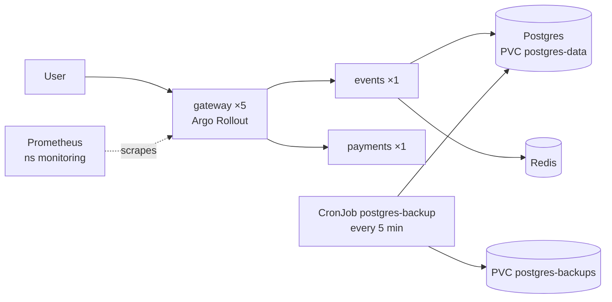

# QuickTicket SRE Handbook

## Architecture



- **gateway** — stateless API router, 5 s timeout to dependencies. Deployed as a canary Rollout.
- **events** — tickets, reservations, orders. Needs Postgres for everything, Redis only for reservation holds. Current capacity bottleneck (~55 RPS).
- **payments** — mock processor. Only `/reserve/{id}/pay` depends on it.
- Everything runs in namespace `default` on k3d cluster `quickticket`. ArgoCD lives in `argocd`, Argo Rollouts in `argo-rollouts`.

## How to Deploy

Git is the source of truth. Never `kubectl apply` to change a running service.

1. Branch, change code in `app/` or manifests in `k8s/`, open a PR, merge to `main`.
2. **Code change:** GitHub Actions builds multi-arch images, pushes `ghcr.io/meliman1000-7/quickticket-<svc>:<sha>` and commits the new tags to `k8s/` (`ci: update image tags …`). **Manifest-only change:** no build runs.
3. ArgoCD (`quickticket` app, path `k8s/`) syncs within ~3 min. Check: `argocd app get quickticket`.
4. gateway rolls out as a canary: 20% → Prometheus error-rate analysis → 50% → 100%. Watch: `kubectl argo rollouts get rollout gateway --watch`.
5. A bad canary aborts itself (error rate ≥ 5% twice). Stable pods are never touched.

**Rollback**
- Canary in progress: `kubectl argo rollouts abort gateway` (traffic back on stable in < 1 s), then `git revert` the commit.
- Already fully rolled out: `git revert <sha> && git push` (~5 min through ArgoCD).

## Monitoring

Prometheus: `kubectl port-forward -n monitoring svc/prometheus 9091:9090` → http://localhost:9091. It scrapes gateway only.

| Question | Query |
|---|---|
| Is traffic flowing? | `sum(rate(gateway_requests_total[1m]))` |
| Are users seeing errors? (SLO: < 0.5%) | `sum(rate(gateway_requests_total{status=~"5.."}[5m])) / sum(rate(gateway_requests_total[5m]))` |
| Which endpoint is failing? | `sum by (path,status)(rate(gateway_requests_total{status=~"5.."}[1m]))` |
| Is it slow? (SLO: 95% < 500 ms) | `histogram_quantile(0.99, sum by (le,path)(rate(gateway_request_duration_seconds_bucket[1m])))` |
| Is one pod or one version bad? | `sum by (pod)(rate(gateway_requests_total[1m]))`, or `by (rs_hash)` during a canary |
| Is anything restarting or saturated? | `kubectl get pods` (RESTARTS), `kubectl top pods` |

409 on `/reserve` means sold out. It is not an error.

## Incident Response

1. **Scope:** `kubectl get pods` and the "which endpoint is failing" query.
2. **Dependencies as gateway sees them:**
   `kubectl run probe --image=curlimages/curl --rm -i --restart=Never --quiet -- curl -s http://gateway:8080/health`
3. **Match the symptom:**

| Symptom | Likely cause | Check | Fix |
|---|---|---|---|
| Only `/pay` fails or is slow | payments degraded | `kubectl logs deploy/payments --tail=20`; `kubectl get deploy payments -o yaml \| grep -A1 PAYMENT_` | Reset `PAYMENT_FAILURE_RATE` / `PAYMENT_LATENCY_MS` to 0 in Git, or `kubectl rollout restart deploy/payments` |
| `/reserve` 504, `/events` fine | Redis down | `kubectl get pods -l app=redis` | `kubectl scale deploy/redis --replicas=1` |
| `/events` 502, `/reserve` 500, load is high | events overloaded: `connection pool exhausted` in `kubectl logs deploy/events`, CPU at 200m | `kubectl top pods -l app=events` | `kubectl scale deploy/events --replicas=3`, then make it permanent in Git |
| Everything 5xx, events log shows DB errors | Postgres down or tables missing | `kubectl exec deploy/postgres -- psql -U quickticket -d quickticket -c '\dt'` | See Backup / Restore |
| Errors started right after a deploy | bad release | `kubectl argo rollouts get rollout gateway`; `git log -3` | Abort / `git revert` (see Rollback) |

4. **After mitigation:** confirm the error ratio is back under 0.5%, then write a blameless postmortem (timeline, root cause, action items).

**Escalation:** not mitigated in 10 min → course TA / service owner.

## Backup / Restore

- **Data:** Postgres data is on PVC `postgres-data`; a pod restart loses nothing (recovery ~6 s, automatic).
- **Backups:** CronJob `postgres-backup` runs `pg_dump -Fc` every 5 min into PVC `postgres-backups` and keeps the 5 newest. RPO ≤ 5 min.
- **Check backups:** `kubectl get cronjob postgres-backup` (LAST SCHEDULE < 5 min); `kubectl get jobs`.
- **Manual backup now:** `kubectl create job --from=cronjob/postgres-backup manual-$(date +%s)`

**Restore** (dropped table, corrupted data, lost volume):
```bash
kubectl exec -i deploy/postgres -- pg_dump -U quickticket -Fc quickticket > before-restore.dump   # if the DB still answers

kubectl run restore --rm -i --restart=Never --image=postgres:17-alpine \
  --overrides='{"spec":{"containers":[{"name":"restore","image":"postgres:17-alpine","stdin":true,
  "env":[{"name":"PGHOST","value":"postgres"},{"name":"PGUSER","value":"quickticket"},
         {"name":"PGPASSWORD","value":"quickticket"},{"name":"PGDATABASE","value":"quickticket"}],
  "command":["sh","-c","F=$(ls -1t /backups/quickticket_*.dump | head -1); echo restoring $F; pg_restore --clean --if-exists -d quickticket $F"],
  "volumeMounts":[{"name":"b","mountPath":"/backups"}]}],
  "volumes":[{"name":"b","persistentVolumeClaim":{"claimName":"postgres-backups"}}]}}'

kubectl rollout restart deployment/events
kubectl exec deploy/postgres -- psql -U quickticket -d quickticket -c 'SELECT count(*) FROM orders'
```
Measured: restore < 1 s for ~5k orders; events restart ~11 s. Everything written after the chosen dump is lost.

**Schema changes:** Alembic, from the repo root with `kubectl port-forward svc/postgres 5432:5432`: `alembic revision -m "…"`, then `alembic upgrade head`. Only additive, nullable changes go out under load.
